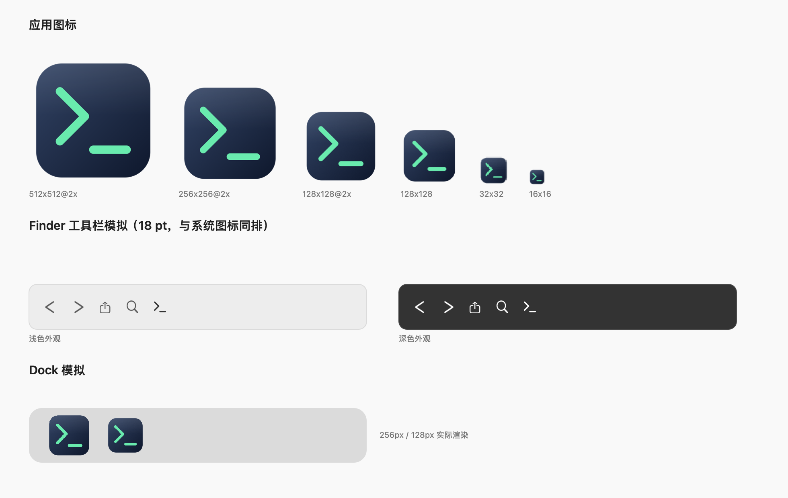

# Interm

在 Finder 里点一下，就在**当前目录**打开终端。纯 Swift 原生实现（AppKit + SwiftUI + FinderSync），没有第三方依赖。

[English](README.md) · **简体中文**

```
Finder 工具栏图标  ──单击──▶  终端已 cd 到该窗口所在目录
```

## 特性

- **一键打开**：把 Interm.app 拖进 Finder 工具栏，单击即在当前 Finder 窗口所在的目录打开终端。
- **原生右键菜单**：附带 FinderSync 扩展，右键窗口背景/选中项出现「在终端中打开」。
- **服务菜单**：Finder 右键 › 服务 › 在终端中打开（默认快捷键 `⌃⌥T`），可自行改键。
- **可脚本化**：`open "interm://open?path=/tmp"`、`Interm --open-at <dir>`。
- **多终端**：Terminal（默认）、iTerm2、Warp、kitty、WezTerm、Alacritty，或自定义「App 路径 + 参数模板」。
- **可诊断**：内置 `--selftest`，设置窗口里能看扩展状态、上次打开的目录、一键跑自检。

## 系统要求

- macOS 14 或更新（在 macOS 27.2 / Xcode 27.2 / Swift 6.4 上开发与实测）
- 构建产物是**当前架构**（本机为 arm64）；没有公证、没有 App Store 分发

## 安装

```bash
git clone <本仓库> Interm && cd Interm

make build       # 编译并组装 dist/Interm.app
make selftest    # 结构与自检（可选）
make install     # 安装到 ~/Applications 并注册扩展
```

安装完做两件事：

1. **把图标放进 Finder 工具栏**（推荐的单键入口）
   打开「应用程序」文件夹，按住 `⌘` 把 `Interm.app` 拖到 Finder 窗口的工具栏上松手。
   之后**单击这个图标**即可在当前目录打开终端。

2. **启用 Finder 扩展**（右键菜单 + 工具栏下拉）
   系统设置 › 通用 › 登录项与扩展 › 扩展 › 访达扩展，勾选 Interm；
   或打开 Interm 的设置窗口，点「启用 / 管理扩展…」。

> 第一次单击工具栏图标时，系统会问「Interm 想要控制访达」。这是读取「当前窗口是哪个目录」的唯一方式，允许一次即可。
> 拒绝的话本次会退回到桌面目录，并弹窗告诉你去哪里改。

想装到 `/Applications`：`make install-system`（可能触发系统的「App 管理」授权）。

## 使用

| 入口 | 操作 | 说明 |
| --- | --- | --- |
| Finder 工具栏 | 单击 Interm 图标 | 在当前 Finder 窗口的目录打开终端 |
| 右键菜单 | 右键窗口背景或选中项 › 在终端中打开 | 由 FinderSync 扩展提供 |
| 服务 | Finder › 服务 › 在终端中打开 | 快捷键 `⌃⌥T`，可在系统设置里改 |
| URL | `open "interm://open?path=/tmp"` | 也可带 `&terminal=iterm2` |
| 命令行 | `Interm --open-at ~/code` | 加 `--dry-run` 只打印将要执行的命令 |
| 状态栏 | 菜单栏图标 › 在终端中打开当前目录 | 与工具栏点击等价 |

设置窗口（菜单栏图标 › 设置…）里可以切换终端、填写自定义参数模板、查看扩展状态、运行自检。

## 支持的终端

| 终端 | 打开方式 | 状态 |
| --- | --- | --- |
| Terminal | 文件夹作为文档交给 LaunchServices | 本机实测 |
| iTerm2 | 同上 | 未装，按官方文档实现 |
| Warp | 同上 | 未装，按官方文档实现 |
| kitty | `kitty --directory <dir>` | 未装 |
| WezTerm | `wezterm start --cwd <dir>` | 未装 |
| Alacritty | `alacritty --working-directory <dir>` | 未装 |
| 自定义 | App 路径 + 参数模板（`{dir}` 占位） | 本机实测（用测试 App 验证过文档打开路径） |

只显示本机已安装的终端；换电脑后设置会自动回落到 Terminal。

## 权限说明

| 权限 | 为什么需要 | 能否避免 |
| --- | --- | --- |
| 自动化（控制「访达」） | 工具栏点击时读取当前窗口目录 | 不能；这是系统唯一提供的途径 |
| 辅助功能 / 完全磁盘访问 | 不需要 | — |
| 扩展沙盒 | FinderSync 扩展的硬性要求 | 不能；扩展只做「取路径 + 转交」，实际启动终端由宿主完成 |

Interm 不联网、不上传任何路径，所有处理都在本机。

## 工作原理（30 秒版）

```
工具栏单击 → 宿主 App（非沙箱）──AppleScript──▶ Finder「当前窗口目录」
                                └──▶ NSWorkspace 把文件夹当文档交给终端（新窗口即在该目录）

右键菜单   → FinderSync 扩展（沙盒）──interm://open?path=…──▶ 宿主 App ──▶ 同上
```

细节、SDK 依据和踩过的坑（例如 FinderSync 的工具栏按钮只能挂下拉菜单、扩展入口点必须是 `NSExtensionMain`）见 [docs/DESIGN.md](docs/DESIGN.md)。

## 常用命令

```bash
make build        # 编译 + 组装 dist/Interm.app
make test         # 单元测试（不需要 GUI）
make install      # 安装到 ~/Applications
make uninstall    # 卸载（先注销扩展再删文件）
make selftest     # 结构 / 签名 / 注册状态 / 运行时自检
make smoke        # 不开窗口验证一次路径解析
make icons        # 重新生成图标
make clean
```

排查见 [docs/TROUBLESHOOTING.md](docs/TROUBLESHOOTING.md)。

## 开发

```
Sources/IntermCore/    与 UI 无关的逻辑（URL、路径归一、预设、启动器、偏好、菜单模型）
Sources/Interm/        宿主 App（CLI、URL、服务、状态栏、SwiftUI 设置）
Sources/IntermFinder/  FinderSync 扩展（沙盒，只做转发）
Tests/IntermCoreTests/ 70 个单元测试
Scripts/               构建、签名、安装、图标、自检
Bundle/                Info.plist、entitlements、生成的图标
```

`swift build` 只产出两个可执行文件；`Scripts/build.sh` 负责组装 `.app`/`.appex`、写 Info.plist、由内向外做 ad-hoc 签名并校验。

## 限制

- 没有 Developer ID 证书，产物是 ad-hoc 签名，未公证；只适合本机/自用。要给他人分发需要自行签名 + 公证。
- 只构建当前架构，不产出 universal binary。
- FinderSync 的工具栏按钮在系统层面只能弹下拉菜单（SDK 没有 `toolbarItemClicked`），所以「一点即开」的是拖到工具栏的 App 图标。

## 图标



App 图标与 Finder 工具栏图标基于 [Lucide](https://lucide.dev/icons/terminal) 的 `terminal` 图标（ISC 许可），
在 [Scripts/make-icons.swift](Scripts/make-icons.swift) 里用 `CGPath` 按原始几何重绘，仓库不存位图素材。
素材与许可说明见 [docs/icons/README.md](docs/icons/README.md)。

## License

MIT，见 [LICENSE](LICENSE)。
